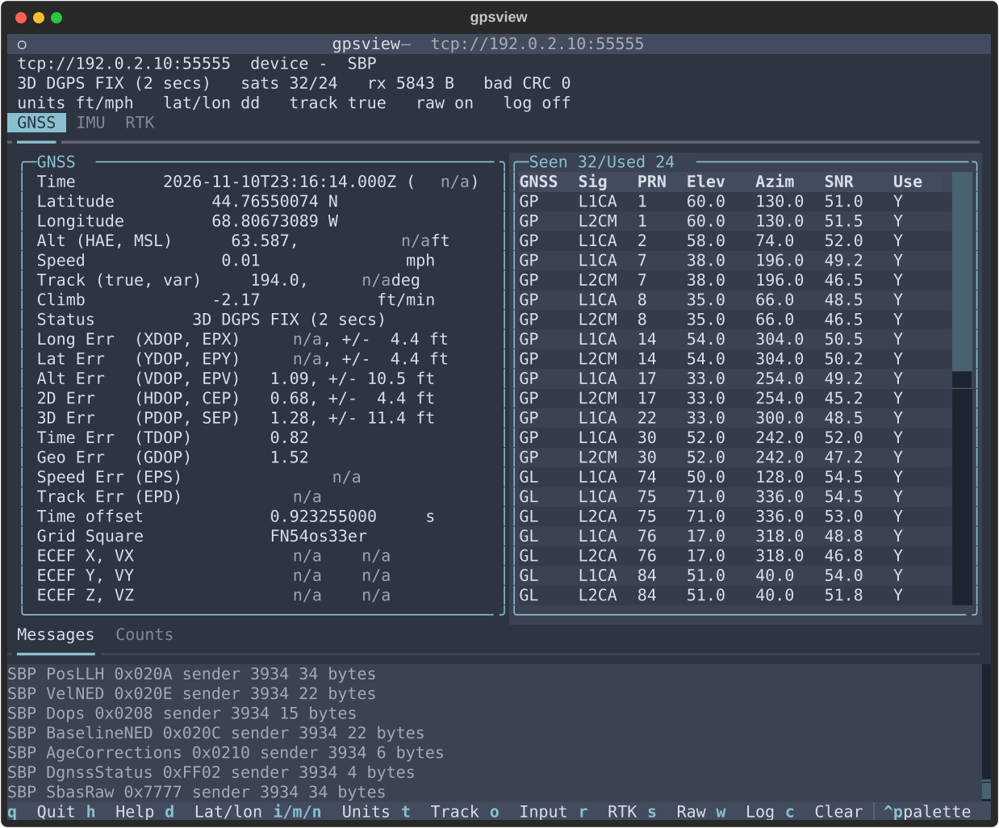
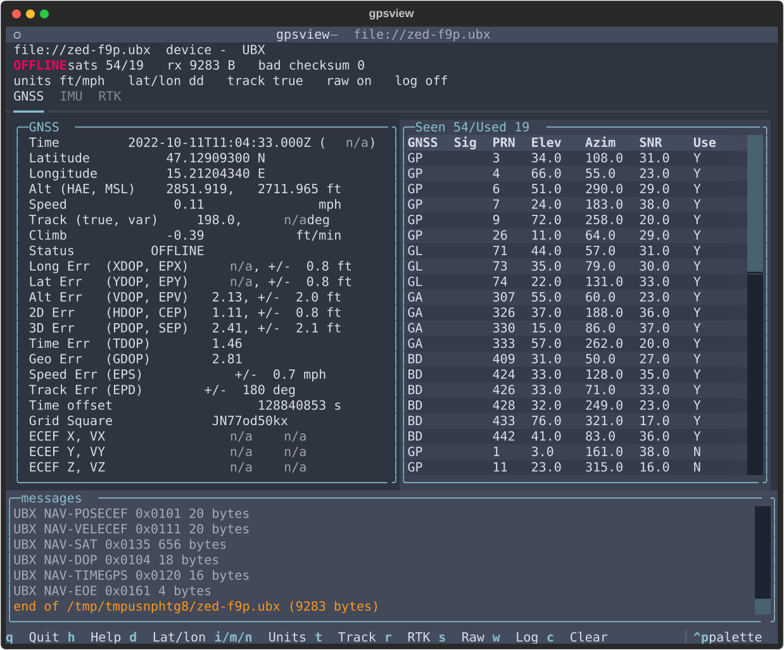
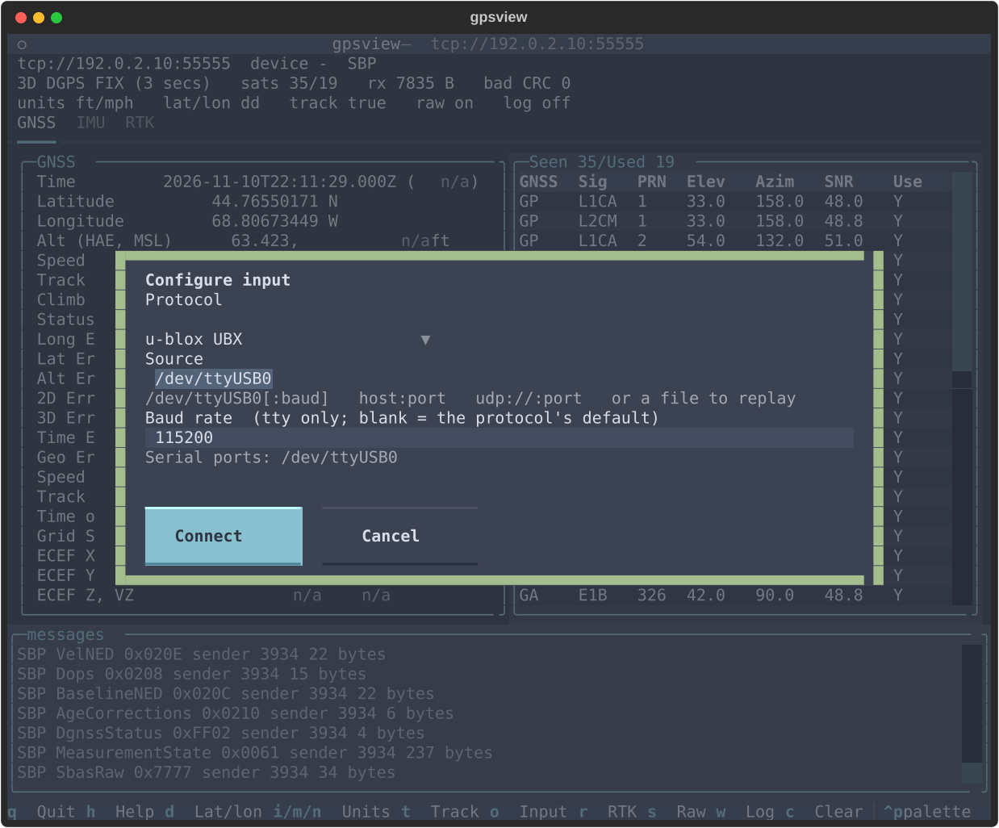
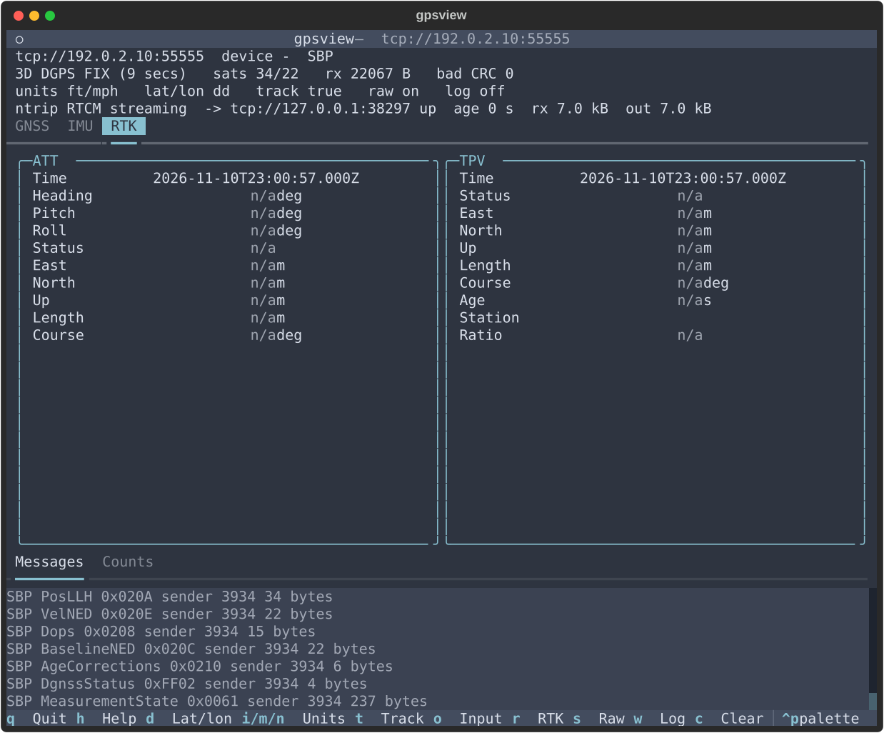
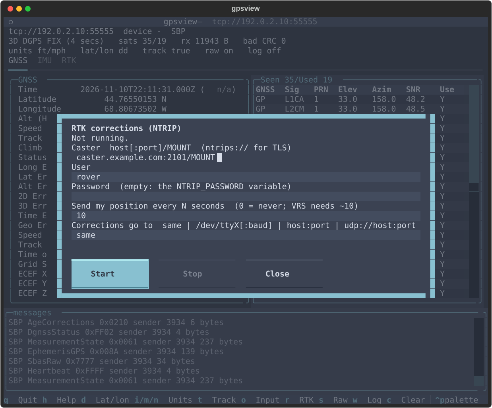

# gpsview

A terminal GNSS viewer built with [Textual](https://textual.textualize.io/), modelled on
**cgps**, the curses client that ships with [gpsd](https://gpsd.io/). It shows the same fix,
error estimates, satellites and raw data, and it can also read a receiver directly, with no
gpsd, and feed it RTK corrections from an NTRIP caster.

The screenshots are 100x40 in Textual's `nord` theme, from a receiver that sends simulated
data (the address in them is a documentation address). `tools/screenshots.py` makes them.

It reads from four sources:

* **gpsd** (the default), as cgps does
* **raw NMEA 0183**, with `-n`, bypassing gpsd
* **Swift Binary Protocol (SBP)**, with `-sbp`, bypassing gpsd
* **u-blox UBX**, with `-ubx`, bypassing gpsd

Every source can be a serial tty, a TCP connection, UDP, or a file (a recording, replayed).

By default it is read-only. It never sends configuration to a receiver. The only bytes it
writes are gpsd's `?WATCH` request, and only when the source is gpsd. The one exception is
**NTRIP**, which you turn on with `--ntrip`: RTCM corrections from a caster are then written
to the receiver, on its data link or on another interface (see [NTRIP](#ntrip-rtk-corrections)).
What it writes is the caster's RTCM frames and nothing else.

## Setup

    git clone https://github.com/millerjs2/gpsview
    cd gpsview
    python3 -m venv .venv
    .venv/bin/pip install -r requirements.txt     # textual, pytest, pyserial, sbp

Needs Python 3.11 or later. Tested with Textual 8.2.8, pyserial 3.5 and sbp 6.5.2 on
Python 3.14. The `sbp` package decodes SBP payloads; `pyserial` opens ttys.

## Run

    bin/gpsview                         # gpsd on localhost:2947
    bin/gpsview pi.local                # gpsd on another host
    bin/gpsview pi.local:2947:/dev/ttyACM0
    bin/gpsview -i                      # start on the IMU tab
    bin/gpsview -r                      # start on the RTK tab
    # press r in the app to set up NTRIP corrections (see "NTRIP" below)
    bin/gpsview -sbp tcp://10.0.0.7:55555   # Swift Binary Protocol over TCP
    bin/gpsview -sbp /dev/ttyUSB0       # SBP on a serial port, baud rate detected
    bin/gpsview -ubx /dev/ttyACM0       # u-blox UBX on a serial port
    bin/gpsview -ubx tcp://10.0.0.7:5000
    bin/gpsview -ubx capture.ubx        # replay a file at serial speed
    bin/gpsview -n /dev/ttyACM0         # NMEA on a serial port
    bin/gpsview -ubx /dev/ttyUSB0 -b 115200     # fixed rate, no scan: -b/--baud, or /dev/ttyUSB0:115200
    bin/gpsview -n udp://:10110         # NMEA datagrams on UDP port 10110
    bin/gpsview -ubx /dev/ttyACM0 --ntrip me@caster.example.com/MOUNT   # RTK, see below
    bin/gpsview --ntrip-list caster.example.com                         # what a caster offers
    bin/gpsview --log                   # start with the raw data being logged to a file
    bin/gpsview --log-dir ~/logs        # put log files somewhere other than where you launch from
    bin/gpsview --help

Options follow cgps: `-i` `-r` `-l {d,m,s}` `-m` `-s` `-u {i,m,n}` `-V`, plus `-n`, `-sbp`,
`-ubx`, `--file-rate`, `--log`, `--log-dir`, and the NTRIP options (`--ntrip`, `--rtcm-out`,
`--ntrip-user`, `--ntrip-version`, `--ntrip-gga`, `--ntrip-list`). Give one source only: a
gpsd server, `-n`, `-sbp`, or `-ubx`.

| Key | Action |
| --- | --- |
| `h` or `?` | Help popup (any key closes it) |
| `q` | Quit |
| `d` | Cycle lat/lon format: DD.dddddddd, DD MM.mmmmmm', DD MM' SS.sssss" |
| `i` `m` `n` | Imperial, metric, nautical units |
| `t` | Show the track as true or magnetic |
| `o` | Input: choose the protocol, source and baud rate (see [below](#choosing-the-input-in-the-app)) |
| `r` | RTK corrections: set up, start or stop NTRIP (see [below](#ntrip-rtk-corrections)) |
| `s` | Raw messages on or off |
| `c` | Clear the raw pane |
| `w` | Start or stop logging the raw data to a file |
| `1` `2` `3` | GNSS, IMU, RTK tab (the tabs are also clickable) |

The GNSS tab has the cgps data panel on the left and the satellite table on the
right. The table lists used satellites first, then by PRN. Its title shows
`Seen/Used`, which counts satellites, not table rows.

The table has one row per signal. SBP reports a satellite once per tracked signal, so a
satellite tracked on L1 and on L2 has two rows, `L1CA` and `L2CM`, with the same
elevation and azimuth. The count is still one satellite. The `Sig` column is the signal
name for SBP, and gpsd's signal id (as cgps shows it) for gpsd. NMEA has no signal
column.

The bottom pane is the **messages** pane: the raw messages from the source (dim: gpsd
JSON, NMEA sentences, or one summary line per SBP frame), and notices in colour:
connection state, the protocol in use, and warnings. `s` turns the raw messages off;
notices still show.

## Sources

### gpsd

`server[:port[:device]]`, as cgps. `?WATCH` is sent on connect. The raw pane shows gpsd's
JSON.

### NMEA 0183 (`-n`)

Each sentence is checked against its `*hh` checksum. A sentence that fails is shown in red
and not used, and the status bar counts it as `bad checksums N`.

Sentences used: GGA, RMC, VTG, GSA, GSV, GST, ZDA. The fix comes from GGA and RMC, the
satellites from GSV and GSA, and the error estimates from GST. Talkers GP, GL, GA, GB/BD,
GQ and GI are mapped to gpsd's constellation numbers.

### Swift Binary Protocol (`-sbp`)

Frames start with 0x55 and end with a CRC-16/XMODEM. A frame with a bad CRC is counted
(`bad CRC N`) and the decoder resynchronises on the next 0x55.

Messages used:

| Message | Shown as |
| --- | --- |
| POS_LLH 0x020A | fix, position, altitude (HAE), position accuracy |
| UTC_TIME 0x0103 | fix time |
| VEL_NED 0x020E | speed, track, climb |
| DOPS 0x0208 | PDOP, HDOP, VDOP, TDOP, GDOP |
| SV_AZ_EL 0x0097 | satellite elevation and azimuth |
| MEASUREMENT_STATE 0x0061 | satellite SNR (cn0), and which satellites are tracked |
| BASELINE_NED 0x020C | RTK base: status, East, North, Up, length, course |

Other messages are listed in the raw pane as one summary line each (for example
`SBP PosLLH 0x020A sender 1 34 bytes`), so the stream is visible even where the
decoder does not use the message.

There is no default address: give `-sbp` a source. The decoder sends nothing to the receiver.
The only thing gpsview ever writes is RTCM from `--ntrip`, if you turn that on.

### u-blox UBX (`-ubx`)

Frames start with `B5 62` and end with a Fletcher checksum. A frame with a bad checksum is
counted (`bad checksum N`) and the decoder resynchronises on the next `B5 62`. A false sync
(a class that does not exist, or a declared length over 8 KB) is stepped over without
waiting for the payload.

Messages used:

| Message | Shown as |
| --- | --- |
| NAV-PVT 0x0107 | fix, time, position, altitude (HAE and MSL), speed, track, climb, accuracies, magnetic variation, and the RTK state (DGPS, RTK float, RTK fixed) |
| NAV-DOP 0x0104 | PDOP, HDOP, VDOP, TDOP, GDOP |
| NAV-SAT 0x0135 | satellites: elevation, azimuth, C/N0, used in the solution, health |
| NAV-SIG 0x0143 | one table row per signal, with the signal name (`L1CA`, `L2CL`, `E1B`, `B1ID1` ...), its C/N0, and whether it is used |
| NAV-RELPOSNED 0x013C | RTK base: status, East, North, Up, length, course, station id (version 0, and version 1 with heading) |
| RXM-RTCM 0x0232 | what the receiver did with the corrections it was sent: type, CRC ok or failed, used or not |

Other messages are listed in the message pane as one line each, for example
`UBX NAV-POSECEF 0x0101 20 bytes`.

A u-blox sends NMEA by default on the same port, and a base station may send RTCM 3. Both
are stepped over without counting errors, and shown in the message pane (`$GNGGA,...`,
`RTCM3 1077 250 bytes`). **NMEA is shown but never used**: only UBX NAV messages feed the
panels, so the display does not flicker between two decoders. If NMEA arrives for 5 s with
no NAV-PVT, the message pane says to enable UBX-NAV-PVT, NAV-SAT and NAV-SIG on that port
(`CFG-MSGOUT-UBX_NAV_PVT_*` in u-center). gpsview does not turn them on for you.

Details that differ from the Swift source:

* **Used** is the receiver's own flag. With NAV-SIG it is per signal (`prUsed`); NAV-SAT's
  `svUsed` is per satellite. Both agree with gpsd on the captures in the tests.
* **Satellites with no tracked signal** (in NAV-SAT but not in NAV-SIG) are one row with no
  signal name.
* **PRN numbers** are gpsd's (`ubx2_to_prn`): GLONASS 64 + slot, Galileo 300 + svId, BeiDou
  400 + svId, QZSS 192 + svId, SBAS 120 to 151 as 33 to 64. GLONASS satellites reported
  with svId 255 (tracked, not yet identified) are left out.
* **Time** is NAV-PVT's date and time, only when both are marked valid; a negative `nano`
  and a leap second (`sec` = 60) are handled.
* **RTK status**: NAV-PVT's `carrSoln` gives the fix status on the GNSS tab. NAV-RELPOSNED
  gives the RTK tab; its `carrSoln` sets the base status, which gpsd leaves unset.
  High-precision parts are included: metres = (cm x 100 + hp) x 1e-4.

### Source forms

| Form | Meaning | Baud |
| --- | --- | --- |
| `/dev/ttyUSB0` | serial tty | detected by listening (see below) |
| `/dev/ttyUSB0:4800` | serial tty at a given baud | 4800 |
| `host:port` or `tcp://host:port` | TCP client | |
| `udp://host:port` | UDP: bind `host` (a local address) and read | |
| `udp://:port` | UDP on all interfaces | |
| `file:///path/x.ubx`, or a path to a regular file | replay a file | |
| `[ipv6]:port`, `udp://[ipv6]:port` | IPv6 (brackets are required) | |

A serial tty needs read access to the device, usually membership of the `dialout` (or
`uucp`) group (and write access too, if it is also where corrections go).

Without a rate, a tty is detected automatically. To skip the scan, set the rate with
`-b RATE` / `--baud RATE` (50 to 4000000) or the `:RATE` suffix. A native USB port (ttyACM) ignores the baud rate, but a USB-to-serial
adapter (ttyUSB) does not. Giving both a suffix and `-b` with different values is an error,
and so is a baud rate for a network source.

**Auto-detecting the baud rate** is the default for a tty with no rate given (`-b auto`, or a
blank or `auto` baud field in the input dialog, say it explicitly). It listens at the protocol's
usual rate first (NMEA 9600, SBP 115200, UBX 38400), then 115200, 38400, 9600, 57600, 19200, 4800,
230400, 460800 and 921600, in turn, for up to 2 s each, and uses the first rate that yields two valid frames (NMEA
sentences with a good checksum, UBX frames with a good checksum, SBP frames with a good CRC).
Noise does not pass those checks, so a wrong rate is not mistaken for a right one. Nothing is
sent to the receiver. It needs the receiver to be sending something: if no rate works the
dialog says whether no bytes arrived (power, port, output disabled) or bytes arrived but nothing
decoded (wrong protocol, or a rate not on the list). The worst case is about 18 s. The detected
rate is used for reconnects too, with no rescan. The dialog that appears when data stops also
has an **Auto-baud** button for a tty, since a wrong rate looks just like that.

### Choosing the input in the app

You do not have to know the command line. Press `o` at any time to open the input dialog: pick
the protocol (gpsd, NMEA, SBP or UBX), type the source, and, for a tty, the baud rate. The
dialog lists the serial ports it can see. **Connect** switches over at once; the state from the
old input is cleared, and the other settings (units, tabs, logging, NTRIP) are kept. A raw log is
closed, because its name includes the protocol, and NTRIP on the data link is stopped if the new
input cannot take corrections (a file or gpsd).

If the input cannot be reached, which is what happens when you start `gpsview` with no
arguments and gpsd is not running, the dialog offers **Retry**, **Configure another input**
or **Quit**. The same choice is offered when the link is lost, at the end of a replayed file, and
when no data arrives for 30 s (where a wrong baud rate is the usual cause). This is only about
where the data comes from; gpsview still sends no configuration commands to the receiver.

**Files** are replayed at 11520 bytes per second (115200 baud, 8N1), so a recording plays as it
would have arrived and not all at once. `--file-rate N` changes the speed in bytes per second;
`--file-rate 0` is as fast as possible. A path counts as a file when it is a regular file
(a tty is a device, not a regular file), or with `file://`. `./x`, `../x` and `~/x` work too.
Any protocol can be replayed, including gpsview's own `gpsview_*.log` files. When the file
ends, the message pane says so and a dialog offers **Replay** or **Quit**: it is not reported as
a lost connection. A file cannot take corrections.

### Logging

`w` starts logging the raw data to a file, and `w` again stops it. `--log` starts logging
as soon as gpsview starts. The file holds the bytes exactly as they arrived, so SBP
and UBX frames are kept intact and can be decoded again later (or replayed with a file source).

The log holds what was received, not what was sent: corrections are not logged.

The file name is `gpsview_<protocol>_yyyymmdd_hhmmZ.log`, where the protocol is `gpsd`,
`nmea`, `sbp` or `ubx`, and the time is UTC. For example `gpsview_sbp_20261110_1343Z.log`. The
file goes in the directory you launched from, or in `--log-dir DIR`. If a file with the
same name already exists (two sessions in the same minute), the new one is
`..._1343Z_2.log`, and an existing file is never overwritten.

The status bar shows `log on` or `log off`. The messages pane names the file when
logging starts and gives its size when logging stops.

## NTRIP (RTK corrections)

An RTK receiver needs a base station's observations as RTCM 3 corrections. An NTRIP caster
serves them over the internet. gpsview can fetch them and write them to the receiver. It is
**off until you ask for it** (`--ntrip`, or the `r` key), and it is the only time gpsview
writes to a receiver.

Press `r` in the app for the RTK dialog: caster URL, user, password, whether to send your
position (GGA), and where the corrections go (`same` is the data link). Start and Stop turn
corrections on and off while the app runs; the status bar then shows the caster, correction
age and the destination. Credentials entered there are kept in memory only. "same" is not
offered for gpsd or file sources, which cannot be written to. The same things as options:

    bin/gpsview --ntrip-list caster.example.com               # mountpoints, and which need GGA
    export NTRIP_USER=me NTRIP_PASSWORD=secret
    bin/gpsview -ubx /dev/ttyACM0 --ntrip caster.example.com/MOUNT
    bin/gpsview -ubx /dev/ttyACM0 --ntrip ntrips://caster.example.com:443/VRS_MOUNT \
                --ntrip-gga 10                                # TLS, and a VRS network

`--ntrip [ntrip://|ntrips://][user[:password]@]host[:port]/mountpoint`. The port defaults to
2101. `ntrips://` is TLS (certificates are checked). `--ntrip-version 1` is for old casters;
the default is version 2, and both are understood in the reply (`ICY 200 OK` and
`HTTP/1.1 200 OK`, including chunked transfer encoding, which would otherwise put chunk
sizes into the RTCM).

**Credentials** come from the URL, then `--ntrip-user`, then `NTRIP_USER` and
`NTRIP_PASSWORD`. A password on the command line shows in `ps` and in shell history, so the
environment is the better place. The password is never shown in the header, status bar,
message pane, log file or error messages (a URL with a bad port is reported without its
`user:password@`).

**Your position is not sent unless you ask.** A VRS mountpoint (`--ntrip-list` shows it as
`gga`) picks its base stations from your position and sends nothing until it has had a GGA
sentence. `--ntrip-gga SECONDS` sends one that often, built from the current fix (so it
works with gpsd, NMEA, SBP and UBX sources). Without it, no position leaves the machine.

### Where the corrections go: `--rtcm-out`

Some receivers take corrections on the port they send data on. Others need them on a
different interface (a u-blox may send data on USB and take corrections on a UART; a Swift
receiver has its own serial port for them). So the destination is chosen separately:

| `--rtcm-out` | Corrections are written to |
| --- | --- |
| `same` (the default) | the link the data comes from: the serial tty or TCP connection. For UDP, the address the datagrams come from. |
| `/dev/ttyUSB1[:baud]` | another serial port (default baud as for the source) |
| `host:port`, `tcp://host:port` | a TCP connection, for a receiver or a serial-to-TCP bridge |
| `udp://host:port` | datagrams to that address. Here the host is where to **send**, unlike a UDP data source, where it is the address to bind. |

Naming the source's own tty (`-ubx /dev/ttyACM0 --rtcm-out /dev/ttyACM0`) is the same as
`same`, since a tty cannot be opened twice. `same` follows the data link through
reconnects: it always writes to the current connection, never to a closed one. It is
refused for **gpsd** (gpsd owns the receiver; give `--rtcm-out`, or let gpsd fetch NTRIP
itself: `gpsd ntrip://...`) and for **files**.

The receiver must be set to accept RTCM 3 on that port (`CFG-UART1INPROT-RTCM3X` or the
USB equivalent for a u-blox). gpsview does not change receiver settings. With UBX, the
receiver confirms what it got: `RXM-RTCM` lines in the message pane (`1077 crc ok, used`) and
`receiver: RTCM ok N bad N` in the status bar. That is the quickest way to tell that the
corrections arrived and were accepted.

### Behaviour

* **Whole frames only.** The stream is split into RTCM frames and each CRC-24Q is checked.
  Only whole, good frames are forwarded, so a datagram never holds half a frame (UDP
  output is packed into datagrams of at most 1400 bytes), and junk from the caster is not
  passed on.
* **Stale corrections are dropped, not queued.** If the destination is down, frames are
  dropped and counted (`dropped` in the status bar), and gpsview retries the connection with
  backoff (1 s up to 15 s). A write that takes more than 2 s is abandoned.
* **The caster connection is kept up.** After a drop or an error it reconnects with backoff
  (1 s up to 60 s), and reconnects if the caster sends nothing for 30 s. It does not retry a
  rejected password (401, 403), a wrong mountpoint (the caster answers with its sourcetable) or
  a redirect: it says why once and stops. The receiver display keeps working.
* **A fourth status line** appears when NTRIP is on:
  `ntrip MOUNT streaming  -> same link up  receiver: RTCM ok 9 bad 0  age 0 s  rx 12.3 kB  1005 1077 1087 1230  out 12.1 kB`.
  `age` is the time since the last whole RTCM frame, and the numbers are RTCM message types.
  The line is cut to the terminal width from the right: the message types, the bytes sent and
  the bytes received go first, so at 80 columns the state, the destination, the receiver's
  report and the age remain. `dropped N kB` replaces `out` when the destination was down.
* `--ntrip-list` removes control characters from what the caster sent before printing it.

Not supported: NTRIP digest authentication, following redirects, client certificates,
proxies, SPARTN, and sending to a receiver anything except RTCM.

## Connection behaviour

* If the source cannot be reached, a dialog offers **Retry**, **Configure another input** or **Quit**.
* If the connection drops, the same dialog appears.
* If no data arrives for 30 s, the dialog offers **Wait**, **Retry**, **Auto-baud** (a tty), **Configure another input** or
  **Quit**. A receiver serves one client at a time, so another phone or PC may have
  taken the stream.
* For gpsd, a different API version from the one this client was written against
  (16.1) shows a yellow warning.

## Try it without hardware

`tools/fake_gpsd.py` is a simulated gpsd on TCP:

    .venv/bin/python tools/fake_gpsd.py            # port 2947, a 3D fix moving in a small circle
    .venv/bin/python tools/fake_gpsd.py --no-fix   # NO FIX
    bin/gpsview localhost:2947

`tools/fake_feeds.py` simulates a raw NMEA, SBP or UBX receiver. It runs on TCP, UDP, or a
pty that stands in for a serial port. It records what the app writes to it
(`FakeFeed.received`), which the NTRIP tests use:

    .venv/bin/python tools/fake_feeds.py nmea --tcp 10110
    bin/gpsview -n tcp://127.0.0.1:10110

    .venv/bin/python tools/fake_feeds.py sbp --udp 10112
    bin/gpsview -sbp udp://:10112

    .venv/bin/python tools/fake_feeds.py sbp --pty    # prints the tty name
    bin/gpsview -sbp /dev/pts/3                        # use the name it printed

    .venv/bin/python tools/fake_feeds.py ubx --tcp 10113   # UBX with NMEA mixed in, RTK fixed
    bin/gpsview -ubx tcp://127.0.0.1:10113

`tools/fake_ntrip.py` is a fake NTRIP caster with mountpoints `RTCM` and `VRS` (which waits for a
GGA), version 1 and 2 replies, chunked encoding, and optional credentials:

    .venv/bin/python tools/fake_ntrip.py --port 2101 --user me --password secret
    NTRIP_PASSWORD=secret bin/gpsview -ubx tcp://127.0.0.1:10113 \
        --ntrip me@127.0.0.1:2101/RTCM --rtcm-out same

## Limitations

These are the places where a source does not give what the view shows. Each shows
`n/a` rather than a guess.

* **NMEA**: no ECEF, no leap seconds, no heading (HDT is not decoded), no DOPs other
  than PDOP/HDOP/VDOP, no climb unless the receiver sends it in another sentence.
* **SBP**: no heading or attitude (the ORIENT messages are not decoded), so the ATT box
  on the IMU tab is empty. IMU_RAW (0x0900) is not decoded, so the IMU tab is empty too.
  No MSL altitude (POS_LLH gives HAE only), no ECEF, no leap seconds.
* **UBX**: no IMU (ESF is not decoded), no ECEF, no leap seconds, no correction age
  (NAV-PVT does not carry it), no NAV-SVINFO (u-blox 6 and 7 have no NAV-SAT: the satellite
  table stays empty and the message pane lists what does arrive), no NAV-HPPOSLLH. Heading and
  the RTK tab need NAV-RELPOSNED, which only the F9P/F9H/M8P and similar send. The track is
  NAV-PVT's heading of motion, which is meaningless when standing still.
* **Used satellites** mean something different for each source:
  * gpsd: its own `used` flag.
  * NMEA: the satellites listed in the GSA sentences of the epoch, one GSA per
    constellation, combined. On the Swift receiver used for testing that is 30, while the
    GGA satellite count (the number in the solution) is 22.
  * UBX: the receiver's own flag (NAV-SAT `svUsed`, NAV-SIG `prUsed`).
  * SBP: "used" means tracked (cn0 > 0), so it is larger than the solution. The solution
    count is `n_sats` in POS_LLH, which is 22 on the same receiver, matching GGA and the
    Swift Navigation console. That 22 is the number to read as "used". No SBP satellite
    message says which satellites are in the solution.
* **GLONASS** in SBP: the satellite number is the slot (1 to 28), shown as PRN 64 + slot
  to follow gpsd. Frequency-channel forms (100 + FCN) are not listed.
* **Signal codes**: the constellation for each SBP satellite comes from the `code` field,
  using libsbp's spec (`spec/yaml/swiftnav/sbp/gnss.yaml`). Codes not in that table are
  not listed.

## Layout and style

The default theme is `nord`; change it from the command palette (Ctrl+P).

The app follows the author's tuiStyle template (a Textual layout guide):

* header, a 3-line status bar on `$boost`, and tabs, with a message pane and a footer
* round `$primary` borders, and theme colours only in the stylesheet
* semantic colours: dim for `n/a`, red for OFFLINE, and the same colours for dialogs
* the connection dialog from the style guide's dead-link section

Changes from the template, which are deliberate:

* **No write path for settings.** The style's `_write()`, confirm dialog and read-back are
  not needed, because the app never changes a receiver's configuration. The one thing it
  writes is RTCM from `--ntrip`, which is opt-in on the command line (so there is no confirm
  dialog) and is not a setting (so there is nothing to read back). The bindings are cgps's,
  not `g`/`p`/`c`.
* **The message pane is shared.** The style's command log is replaced by one pane
  holding raw data and notices, as cgps's messages window does. It takes the rows left
  over after the tabs (at least 5), so 80x24 terminals still show data.

## Differences from cgps

cgps is the reference. These are the places where gpsview differs on purpose.

| cgps | gpsview | Why |
| --- | --- | --- |
| EPD (track error, in degrees) is multiplied by the speed factor (mph, knots or km/h) | EPD is shown in degrees | cgps passes `speedfactor` for EPD. That is a bug. |
| sigid 10 to 12 is printed as `:` `;` `<` (ASCII after `9`) | shown as `A` `B` `C` | Same width, and the characters are readable. |
| Gyro rates are labelled `deg/s^2` | `deg/s` | The unit of a gyro rate is deg/s. |
| "ATT" Gyro T / Gyro X come from libgps, which writes the `gyro_temp` key into `gyro_x` (`libgps/libgps_json.c`, the ATT table) | `gyro_temp` is read into Gyro T | libgps bug. The IMU table in the same file is correct. |
| The satellite list and DOP/ECEF blocks are cut when the window is short, with "More..." | Everything is shown and the panel scrolls | Simpler than fitting by terminal height. |
| Satellite table fits beside the data panel at 80 columns | Needs about 100 columns for all columns; narrower terminals scroll it sideways | The Textual table has padding. |
| `s` hides the message window (`-s` silences it) | `s` turns raw data off; notices still show | The message pane is also where notices go. |
| Version mismatch: warning, then a 4 s pause | Warning only | No pause in a UI. |
| Cannot connect: prints an error and exits | Dialog with Retry, Configure another input or Quit | Lets you start the source and carry on. |
| No data for 2 minutes: exits | Dialog after 30 s with Wait | Same idea, shorter, and it asks first. |
| IMU and RTK come only from `-i` / `-r` | Also switchable with `1` `2` `3` | Tabs in the style. |
| Leap seconds are shown as `(0)` if gpsd omits them | Shown as `(n/a)` | Not every source has them. |
| "SNARD" when there is no ATT time | `n/a` | Joke text. |
| `-D` debug level for libgps | Not implemented | Not needed for a Textual client. |

## Files

    bin/gpsview              launcher (uses .venv if present)
    gpsview/__main__.py      command line: gpsd server, -n, -sbp, -ubx, --baud, --ntrip
    gpsview/app.py           the Textual app, key bindings, dialogs, the read loop
    gpsview/autobaud.py      baud-rate detection by listening (never writes)
    gpsview/sources.py       builds a Feed from protocol + source + baud (CLI and the input dialog)
    gpsview/feeds.py         Feed (transport + decoder), decoder events
    gpsview/transports.py    TCP, UDP, serial and file transports; endpoint parsing
    gpsview/client.py        gpsd: server string, ?WATCH, JSON decoder
    gpsview/nmea.py          NMEA 0183 decoder -> TPV, SKY
    gpsview/swift.py         SBP framing, CRC, decoder -> TPV, SKY, ATT
    gpsview/ubx.py           UBX framing, checksum, decoder -> TPV, SKY, ATT
    gpsview/rtcm.py          RTCM 3 framing, CRC-24Q, message types (no decoding)
    gpsview/ntrip.py         NTRIP client, sourcetable, session (reconnect, GGA, stats)
    gpsview/corrections.py   where corrections go: same link, tty, TCP, UDP (--rtcm-out)
    gpsview/logfile.py       the raw data log (gpsview_<protocol>_yyyymmdd_hhmmZ.log)
    gpsview/model.py         decoded objects -> plain state (no I/O)
    gpsview/fmt.py           number and coordinate formatting, ported from C
    gpsview/views.py         panel text: GNSS, satellites, IMU, RTK, status bar
    gpsview/gpsview.tcss     stylesheet
    tools/fake_gpsd.py       simulated gpsd for demos and tests
    tools/fake_feeds.py      simulated NMEA, SBP and UBX receivers (TCP, UDP, pty)
    tools/fake_ntrip.py      simulated NTRIP caster (v1, v2, chunked, auth, VRS)
    tools/screenshots.py     regenerates docs/screenshots/*.svg (100x40, nord)
    docs/screenshots/        the README screenshots
    tools/golden/            regenerates tests/golden_fmt.tsv from the C code
    tests/                   unit, golden and end-to-end tests

## Tests

    .venv/bin/python -m pytest -q

* `test_fmt.py` checks 276 formatter outputs against the C code. The C is taken
  from a gpsd checkout (`~/dev/gpsd` by default, or `$GPSD_SRC`) and compiled with gcc. To regenerate the golden file after
  changing the gpsd source:

      tools/golden/gen_golden.sh /path/to/gpsd

* `test_model.py`, `test_client.py` and `test_views.py` cover parsing, the gpsd server
  string, and the panel text.
* `test_transports.py` covers the endpoint forms, UDP loopback, TCP, and a pty standing
  in for a serial port.
* `test_nmea.py` covers checksums, each sentence, epochs, malformed input, and input
  split across reads. The sample sentences are the published NMEA examples, with
  their checksums checked.
* `test_swift.py` builds frames with the `sbp` package's own encoder and covers framing,
  CRC errors, resynchronisation, and each mapping.
* `test_ubx.py` covers framing, each message mapping, mixed NMEA/RTCM streams, and decodes
  real receiver captures (u-blox 8, M8P, ZED-F9P, F9R, F9V) from gpsd's `test/daemon` directory (`$GPSD_SRC`, default `~/dev/gpsd`),
  comparing positions, satellites, signals, used flags and DOPs with gpsd's own decode in the
  `.chk` files. Those tests are skipped if gpsd is not checked out there (set `$GPSD_SRC`). The rest use frames
  built from the u-blox layouts.
* `test_ntrip.py` runs the client against `tools/fake_ntrip.py`: both versions, chunked
  encoding, wrong credentials, wrong mountpoint, sourcetable, VRS, reconnects, and that the
  forwarded RTCM is byte-exact and whole-frame. `test_corrections.py` covers the sinks.
  `test_autobaud.py` covers frame scoring, the scan (with a fake receiver that is only readable at
  its true rate), and the dialogs. `test_input_dialog.py` covers the baud rate and the input dialog (from the connection dialog and
  the `o` key). `test_ntrip_dialog.py` drives the RTK dialog and the footer at 100x40.
  `test_ntrip_app.py` runs the app with a fake receiver and a fake caster, with corrections on
  the data link (TCP, pty, UDP), on a separate interface, across a reconnect, and checks the
  GGA the caster received and that the password appears nowhere.
* `test_app.py` runs the Textual app against `tools/fake_gpsd.py` over TCP. It covers
  keys, the help popup, no fix, a refused connection, a dropped connection and retry,
  and the stall dialog.
* `test_feeds.py` runs the app against the fake NMEA and SBP receivers over TCP, UDP
  and a pty.
* `test_cli.py` covers the source options and the refusals (two sources, a bad spec).
* `test_logfile.py` covers the log file name (UTC), the suffix for a second file in the
  same minute, and the app writing the received bytes.

The NMEA and SBP sources have been checked against simulated receivers, and the SBP source
against a live Swift receiver over TCP.

UBX has been checked against real captures (above) and the fake receiver, and NTRIP against
the fake caster. NTRIP was also run live against two public/commercial casters (NTRIP v2, one
with a single-base mountpoint) with the corrections sent to a Swift receiver's RTCM input on a
separate TCP port while the data was read as SBP on another: no CRC errors, destination up,
correction age 0 to 1 s, and the receiver reporting RTK fixed, and RTK was switched off and on
by stopping and starting the NTRIP session. A u-blox receiver has not been tried live, so UBX
(including the RXM-RTCM feedback) is checked only against gpsd's captures.

## License

MIT, see [LICENSE](LICENSE). The number and coordinate formatting in `gpsview/fmt.py` is
ported from gpsd (BSD-2-Clause), which is compatible.
